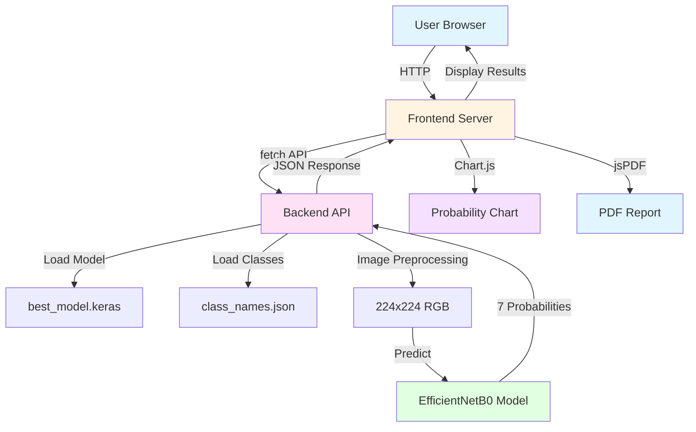

# DermAI Architecture Diagram

## System Overview

```
┌─────────────────────────────────────────────────────────────────────────────┐
│                              DERM AI SYSTEM                                   │
│                        Skin Lesion Classification                          │
└─────────────────────────────────────────────────────────────────────────────┘

┌──────────────────────┐         ┌──────────────────────┐         ┌──────────────────────┐
│                      │         │                      │         │                      │
│   USER INTERFACE    │         │   BACKEND SERVER    │         │   MACHINE LEARNING   │
│   (Frontend)        │         │   (Flask API)        │         │   (EfficientNetB0)   │
│                      │         │                      │         │                      │
│  - HTML/CSS/JS      │         │  - Python/Flask      │         │  - TensorFlow/Keras   │
│  - Chart.js          │  HTTP   │  - TensorFlow        │  Model  │  - best_model.keras   │
│  - jsPDF             │◄──────►│  - PIL/Pillow        │◄──────►│  - 224x224x3 input    │
│  - html2canvas       │  JSON   │  - EfficientNet      │  Load   │  - 7 class output    │
│                      │         │    preprocessing     │         │                      │
│  Port: 3000          │         │                      │         │                      │
│                      │         │  Port: 5000          │         │                      │
└──────────────────────┘         └──────────────────────┘         └──────────────────────┘
                                        │                                    │
                                        │                                    │
                                        ▼                                    ▼
                              ┌──────────────────────┐         ┌──────────────────────┐
                              │                      │         │                      │
                              │   DATA STORAGE      │         │   CLASS DEFINITIONS  │
                              │                      │         │                      │
                              │  - Uploaded Images   │         │  - class_names.json   │
                              │  - (Temporary)      │         │  - 7 skin lesion     │
                              │                      │         │    classes            │
                              └──────────────────────┘         └──────────────────────┘
```

## Detailed Architecture

### 1. Frontend Layer (Client-Side)

```
┌─────────────────────────────────────────────────────────────────────┐
│                         FRONTEND LAYER                               │
│                    Port: 3000 | HTTP Server                           │
└─────────────────────────────────────────────────────────────────────┘

┌─────────────────────────────────────────────────────────────────────┐
│ Components:                                                           │
│                                                                       │
│  ┌──────────────┐    ┌──────────────┐    ┌──────────────┐           │
│  │   index.html │    │  styles.css  │    │  script.js   │           │
│  │              │    │              │    │              │           │
│  │ - UI Layout  │    │ - Styling   │    │ - Logic      │           │
│  │ - Forms      │    │ - Responsive│    │ - API Calls  │           │
│  │ - Report     │    │ - Themes    │    │ - Validation │           │
│  └──────────────┘    └──────────────┘    └──────────────┘           │
│                                                                       │
│  External Libraries:                                                   │
│  ┌──────────────┐    ┌──────────────┐    ┌──────────────┐           │
│  │   Chart.js   │    │    jsPDF     │    │ html2canvas  │           │
│  │              │    │              │    │              │           │
│  │ - Charts     │    │ - PDF Gen    │    │ - Image Cap  │           │
│  │ - Visuals    │    │ - Reports    │    │ - PDF Image  │           │
│  └──────────────┘    └──────────────┘    └──────────────┘           │
└─────────────────────────────────────────────────────────────────────┘
```

### 2. Backend Layer (Server-Side)

```
┌─────────────────────────────────────────────────────────────────────┐
│                        BACKEND LAYER                                 │
│                    Port: 5000 | Flask API                             │
└─────────────────────────────────────────────────────────────────────┘

┌─────────────────────────────────────────────────────────────────────┐
│ Flask Application Structure:                                          │
│                                                                       │
│  ┌─────────────────────────────────────────────────────────────┐   │
│  │                      app.py                                 │   │
│  │                                                              │   │
│  │  Endpoints:                                                  │   │
│  │                                                              │   │
│  │  GET  /health         → Server health check                 │   │
│  │  GET  /diagnostic     → Model information                  │   │
│  │  POST /predict        → Image classification                │   │
│  │                                                              │   │
│  │  Processing:                                                │   │
│  │  1. Receive image (multipart/form-data)                      │   │
│  │  2. Validate file existence                                  │   │
│  │  3. Convert to RGB (if needed)                              │   │
│  │  4. Resize to 224x224                                        │   │
│  │  5. Apply EfficientNet preprocessing                         │   │
│  │  6. Model prediction                                        │   │
│  │  7. Return JSON response                                    │   │
│  └─────────────────────────────────────────────────────────────┘   │
│                                                                       │
│  Dependencies:                                                       │
│  - Flask: Web framework                                            │
│  - Flask-CORS: Cross-origin support                                │
│  - TensorFlow: ML framework                                        │
│  - PIL/Pillow: Image processing                                   │
│  - NumPy: Numerical operations                                     │
└─────────────────────────────────────────────────────────────────────┘
```

### 3. Model Layer (Machine Learning)

```
┌─────────────────────────────────────────────────────────────────────┐
│                       MODEL LAYER                                     │
│                   EfficientNetB0 Architecture                         │
└─────────────────────────────────────────────────────────────────────┘

┌─────────────────────────────────────────────────────────────────────┐
│ Model Configuration:                                                  │
│                                                                       │
│  Input:  (None, 224, 224, 3) - RGB Image                            │
│  Output: (None, 7) - 7 Class Probabilities                          │
│  Model:  best_model.keras (16.36 MB)                                │
│  Layers: 5 (EfficientNetB0 backbone + classification head)          │
│                                                                       │
│  Preprocessing:                                                      │
│  - ImageNet mean subtraction                                        │
│  - RGB channel normalization                                         │
│  - EfficientNet-specific scaling                                    │
│                                                                       │
│  Classes (7):                                                        │
│  0. akiec  → Actinic Keratoses                                     │
│  1. bcc    → Basal Cell Carcinoma                                  │
│  2. bkl    → Benign Keratosis                                      │
│  3. df     → Dermatofibroma                                        │
│  4. mel    → Melanoma                                              │
│  5. nv     → Melanocytic Nevi                                      │
│  6. vasc   → Vascular Lesions                                      │
└─────────────────────────────────────────────────────────────────────┘
```

## Data Flow Diagram

```
USER ACTION → IMAGE UPLOAD → PREPROCESSING → MODEL PREDICTION → RESULTS DISPLAY
     │              │              │                │                  │
     │              │              │                │                  │
     ▼              ▼              ▼                ▼                  ▼
┌─────────┐   ┌─────────┐   ┌─────────┐   ┌─────────┐   ┌─────────┐
│ Select  │   │ Upload  │   │ Resize  │   │ Forward │   │ Display │
│ Image   │   │ to API  │   │ 224x224 │   │  Pass   │   │ Results │
│         │   │         │   │ + Norm  │   │         │   │ + Chart │
└─────────┘   └─────────┘   └─────────┘   └─────────┘   └─────────┘
                    │              │                │                  │
                    │              │                │                  │
                    ▼              ▼                ▼                  ▼
              ┌─────────┐   ┌─────────┐   ┌─────────┐   ┌─────────┐
              │ HTTP    │   │ RGB     │   │ 7-Class │   │ PDF     │
              │ POST    │   │ Convert │   │ Prob    │   │ Report  │
              │ /predict│   │ + Pre   │   │ Array   │   │ Download│
              └─────────┘   │ process │   └─────────┘   └─────────┘
                            └─────────┘
```

## API Endpoints

```
┌─────────────────────────────────────────────────────────────────────┐
│                          API ENDPOINTS                               │
└─────────────────────────────────────────────────────────────────────┘

1. GET /health
   Purpose: Health check
   Response:
   {
     "status": "healthy",
     "model_loaded": true,
     "model_path": "C:\\DermAI\\backend\\best_model.keras",
     "class_names": ["akiec", "bcc", "bkl", "df", "mel", "nv", "vasc"],
     "model_input_shape": "(None, 224, 224, 3)",
     "model_output_shape": "(None, 7)"
   }

2. GET /diagnostic
   Purpose: Model diagnostic information
   Response:
   {
     "model_path": "C:\\DermAI\\backend\\best_model.keras",
     "model_exists": true,
     "model_size_mb": 16.36,
     "class_names": ["akiec", "bcc", "bkl", "df", "mel", "nv", "vasc"],
     "class_indices": {...},
     "model_input_shape": "(None, 224, 224, 3)",
     "model_output_shape": "(None, 7)",
     "num_classes": 7,
     "preprocessing": "EfficientNet ImageNet preprocessing"
   }

3. POST /predict
   Purpose: Image classification
   Request: multipart/form-data with 'image' field
   Response:
   {
     "prediction": "mel",
     "confidence": 0.85,
     "all_probabilities": [
       {"class": "mel", "probability": 0.85},
       {"class": "bcc", "probability": 0.10},
       {"class": "nv", "probability": 0.03},
       ...
     ]
   }
```

## File Structure

```
DermAI/
│
├── backend/
│   ├── app.py                    # Flask API server
│   ├── best_model.keras          # Trained EfficientNetB0 model (16.36 MB)
│   ├── class_names.json          # Class definitions (7 classes)
│   └── requirements.txt          # Python dependencies
│
├── frontend/
│   ├── index.html                # Main HTML page
│   ├── styles.css                # Styling and responsive design
│   ├── script.js                 # Frontend logic and API calls
│   └── server.py                 # Python HTTP server (port 3000)
│
├── evaluation_results/           # (Generated after model evaluation)
│   ├── confusion_matrix.png
│   ├── metrics.txt
│   └── detailed_results.csv
│
├── test_data/                    # (User-provided test images)
│   ├── akiec/
│   ├── bcc/
│   ├── bkl/
│   ├── df/
│   ├── mel/
│   ├── nv/
│   └── vasc/
│
├── evaluate_model.py             # Model evaluation script
├── DIAGNOSTIC_REPORT.md         # Diagnostic analysis report
├── EVALUATION_REQUIREMENTS.md   # Evaluation data requirements
├── ANALYSIS_REPORT_FEATURE.md   # Analysis report feature docs
└── ARCHITECTURE.md              # This file
```

## Security & Safety Features

```
┌─────────────────────────────────────────────────────────────────────┐
│                      SAFETY & VALIDATION                              │
└─────────────────────────────────────────────────────────────────────┘

Input Validation:
  ✓ File type validation (JPG, PNG, JPEG only)
  ✓ File size validation (max 10MB)
  ✓ Image resolution validation (100-4000px)
  ✓ RGB conversion for consistent processing

Error Handling:
  ✓ Invalid image rejection
  ✓ Backend error logging
  ✓ Frontend error alerts
  ✓ Graceful degradation

Medical Safety:
  ✓ Educational disclaimer in footer
  ✓ Disclaimer in analysis report
  ✓ Disclaimer in PDF reports
  ✓ Low-confidence warnings (<50%)
  ✓ No claims of medical diagnosis
  ✓ Recommendation to consult dermatologist

Data Privacy:
  ✓ No image storage on server
  ✓ Temporary processing only
  ✓ No user data collection
  ✓ Local model inference only
```

## Technology Stack

```
┌─────────────────────────────────────────────────────────────────────┐
│                      TECHNOLOGY STACK                                │
└─────────────────────────────────────────────────────────────────────┘

Frontend:
  - HTML5 (Markup)
  - CSS3 (Styling)
  - JavaScript (Logic)
  - Chart.js 4.4.0 (Visualization)
  - jsPDF 2.5.1 (PDF Generation)
  - html2canvas 1.4.1 (Image Capture)

Backend:
  - Python 3.12
  - Flask 3.0.0 (Web Framework)
  - Flask-CORS 4.0.0 (Cross-Origin Support)
  - TensorFlow 2.16.1 (ML Framework)
  - PIL/Pillow 10.1.0 (Image Processing)
  - NumPy 1.26.4 (Numerical Computing)

Machine Learning:
  - EfficientNetB0 (Architecture)
  - Keras 3.15.1 (High-Level API)
  - TensorFlow 2.16.1 (Low-Level API)
  - ImageNet Preprocessing (Normalization)

Development:
  - Python HTTP Server (Frontend Serving)
  - Flask Development Server (Backend API)
  - Git (Version Control)
```

## Deployment Considerations

```
┌─────────────────────────────────────────────────────────────────────┐
│                   DEPLOYMENT ARCHITECTURE (Future)                     │
└─────────────────────────────────────────────────────────────────────┘

Production Setup (Recommended):

┌──────────────┐    ┌──────────────┐    ┌──────────────┐
│   Nginx       │    │   Gunicorn    │    │   Docker     │
│   (Reverse    │    │   (WSGI       │    │   (Container  │
│    Proxy)     │◄──►│    Server)    │◄──►│    Image)    │
│   Port 80/443 │    │   Port 5000   │    │              │
└──────────────┘    └──────────────┘    └──────────────┘
       │                   │                   │
       │                   │                   │
       ▼                   ▼                   ▼
   ┌─────────┐       ┌─────────┐       ┌─────────┐
   │  HTTPS  │       │  Flask  │       │  Model  │
   │  SSL/TLS│       │   API   │       │  File   │
   └─────────┘       └─────────┘       └─────────┘

Current (Development):
  - Python HTTP Server (Frontend)
  - Flask Development Server (Backend)
  - Debug mode enabled
  - Localhost only
```

## Performance Considerations

```
┌─────────────────────────────────────────────────────────────────────┐
│                   PERFORMANCE METRICS                                 │
└─────────────────────────────────────────────────────────────────────┘

Model Inference:
  - Model size: 16.36 MB
  - Input size: 224x224x3 (150,528 pixels)
  - Forward pass time: ~100-500ms (CPU dependent)
  - Memory usage: ~500MB RAM

API Response:
  - Typical response time: 200-600ms
  - Image upload time: Variable (based on file size)
  - Total request time: 1-2 seconds average

Frontend:
  - Page load: <1 second
  - Chart rendering: <100ms
  - PDF generation: 1-3 seconds
  - Memory usage: ~100MB RAM
```

## Limitations & Known Issues

```
┌─────────────────────────────────────────────────────────────────────┐
│                   LIMITATIONS & ISSUES                               │
└─────────────────────────────────────────────────────────────────────┘

Model Limitations:
  - Trained on HAM10000 dataset only
  - Dataset imbalance (nv is 67% of samples)
  - May have bias toward majority class
  - Not validated on external datasets
  - Accuracy unknown without proper evaluation

System Limitations:
  - CPU-only inference (no GPU acceleration)
  - Single-user deployment (no concurrent request handling)
  - No user authentication
  - No image storage/database
  - No model versioning
  - No A/B testing capability

Preprocessing:
  - Assumes ImageNet preprocessing (cannot verify without training code)
  - Fixed 224x224 resolution
  - RGB only (no grayscale support)
```

## Future Enhancements

```
┌─────────────────────────────────────────────────────────────────────┐
│                   FUTURE ENHANCEMENTS                                │
└─────────────────────────────────────────────────────────────────────┘

Short-term:
  ✓ Add user authentication
  ✓ Implement request rate limiting
  ✓ Add model versioning
  ✓ Implement database for prediction history
  ✓ Add image upload history
  ✓ Improve error handling

Medium-term:
  ✓ GPU acceleration for faster inference
  ✓ Batch prediction support
  ✓ Model ensemble for better accuracy
  ✓ Add confidence calibration
  ✓ Implement model monitoring
  ✓ Add automated testing pipeline

Long-term:
  ✓ Multi-model support (different architectures)
  ✓ Real-time video analysis
  ✓ Mobile app (React Native)
  ✓ Cloud deployment (AWS/GCP/Azure)
  ✓ API rate limiting and billing
  ✓ HIPAA compliance for medical use
```

## Monitoring & Logging

```
┌─────────────────────────────────────────────────────────────────────┐
│                   MONITORING & LOGGING                               │
└─────────────────────────────────────────────────────────────────────┘

Current Logging:
  - Flask server logs (INFO level)
  - TensorFlow logs (INFO level)
  - Prediction logs (detailed)
  - Error logs (with stack traces)

Logging Information:
  - Model loading status
  - File reception details
  - Image preprocessing stats
  - Raw prediction arrays
  - Prediction confidence
  - Error details

Future Monitoring:
  - Response time tracking
  - Error rate monitoring
  - Prediction distribution analysis
  - Model performance metrics
  - User analytics
  - System health dashboard
```

## Mermaid Diagram (Visual)


